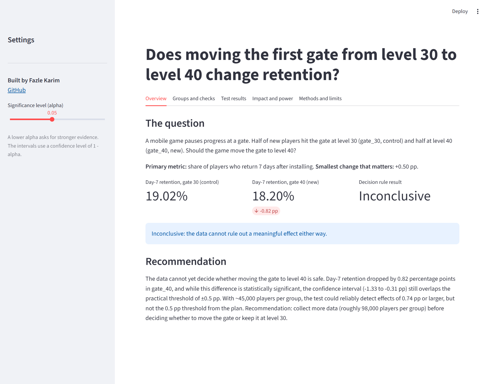

# Cookie Cats A/B Test

**Does moving the first gate from level 30 to level 40 change player retention?**

**Live app:** https://cookie-cats-ab-test.streamlit.app/

**Result:** Moving the gate to level 40 lowered day-7 retention by 0.82 percentage points (95% CI −1.33 to −0.31 pp, p = 0.0016). The interval includes drops both smaller and larger than the 0.5 pp threshold set in advance, so the pre-registered decision rule returns **inconclusive**.

**Recommendation (my judgement, not the rule):** keep the gate at level 30. There is no evidence that level 40 improves retention, and more data would only pin down how large the loss is. The bigger open question is revenue: a monetization gain is the only reason to accept a retention loss.



---

## The result in one paragraph

Moving the first gate from level 30 to level 40 reduced day-7 retention by 0.82 percentage points (95% CI −1.33 to −0.31 pp, p = 0.0016). The effect is statistically significant, but the confidence interval still overlaps the ±0.5 pp practical threshold defined in the analysis plan, so the pre-registered decision rule returns **inconclusive**. The test was powered to detect effects of 0.74 pp or larger, but not the 0.5 pp threshold — with ~45,000 players per group, effects in the 0.5–0.74 pp range cannot be reliably distinguished from zero. Secondary metrics (day-1 retention and game rounds) show no significant effect after Holm correction. Recommendation: keep the gate at level 30 for now, and collect more traffic before deciding.

---

## What this project does

- Loads the public Cookie Cats A/B test dataset (~90,000 players) into SQLite
- Runs data quality checks (duplicates, missing values, outliers, logic checks)
- Computes primary and secondary metrics per group with SQL
- Tests the primary metric with a two-proportion z-test and a bootstrap cross-check
- Applies a pre-registered decision rule with a practical threshold
- Runs power analysis and computes the minimum detectable effect
- Serves the results as a live, interactive Streamlit app

The analysis plan was committed **before** looking at the results (see `docs/analysis_plan.md` and its Git commit timestamp).

---

## Key numbers

| Metric | gate_30 (control) | gate_40 (treatment) | Difference |
|---|---|---|---|
| Day-7 retention (primary) | 19.02% | 18.20% | −0.82 pp (95% CI −1.33 to −0.31) |
| Day-1 retention (guardrail) | 44.82% | 44.23% | −0.59 pp (95% CI −1.24 to +0.06) |
| Median game rounds | 17 | 16 | −1 |
| Mean game rounds (trimmed) | 50.02 | 49.92 | −0.10 |

**Decision rule outcome:** inconclusive — the CI straddles the ±0.5 pp threshold.

**Minimum detectable effect (80% power):** 0.74 pp.

**Players needed to detect 0.5 pp:** ~97,700 per group.

---

## How to run

Requires Python 3.11 or 3.12.

```bash
git clone https://github.com/Fazle-Karim/cookie-cats-ab-test.git
cd cookie-cats-ab-test
python -m venv .venv
.venv\Scripts\Activate.ps1
pip install -r requirements.txt pytest ipykernel matplotlib
```

Download `cookie_cats.csv` from Kaggle and place it in `data/raw/`:

https://www.kaggle.com/datasets/yufengsui/mobile-games-ab-testing-cookie-cats

Then run the pipeline:

```bash
python scripts/load_to_sqlite.py
python scripts/run_analysis.py
python scripts/build_summary.py
streamlit run streamlit_app.py
```

Run the unit tests:

```bash
python -m pytest
```

---

## Project structure

```text
cookie-cats-ab-test/
├── streamlit_app.py
├── requirements.txt
├── pytest.ini
├── abtest/
│   └── stats.py
├── scripts/
│   ├── load_to_sqlite.py
│   ├── run_analysis.py
│   └── build_summary.py
├── sql/
│   ├── 01_quality_checks.sql
│   ├── 02_group_metrics.sql
│   └── 03_engagement_funnel.sql
├── tests/
│   └── test_stats.py
├── data/
│   ├── raw/
│   └── processed/
├── docs/
│   ├── analysis_plan.md
│   ├── data_quality.md
│   ├── results.md
│   ├── results_notes.md
│   ├── memo.md
│   └── decision_log.md
├── notebooks/
│   └── analysis.ipynb
└── README.md
```

---

## Tools used

- **SQL (SQLite)** — data quality checks, group metrics, engagement funnel, window functions
- **Python** — pandas, numpy, scipy
- **Statistics** — two-proportion z-test, bootstrap, Welch t-test, Holm correction, power analysis
- **Streamlit** — interactive app with metric selection, impact calculator, power calculator
- **pytest** — 13 unit tests validating the statistics module

---

## Methods in brief

- **Primary metric:** day-7 retention, chosen before looking at results.
- **Test:** two-proportion z-test, two-sided at α = 0.05. Uses a pooled standard error for the test and separate standard errors for the confidence interval.
- **Cross-check:** parametric bootstrap (10,000 simulations) confirms the formula interval.
- **Secondary metrics:** day-1 retention and game rounds (Mann-Whitney U; Welch t-test after removing the top 0.1%). P-values adjusted with Holm correction.
- **Decision rule:** pre-registered in `docs/analysis_plan.md`. Threshold ±0.5 pp.
- **Power:** minimum detectable effect at 80% power with the observed sample.

---

## Data credit

The dataset is the public **Mobile Games A/B Testing — Cookie Cats** dataset on Kaggle:

https://www.kaggle.com/datasets/yufengsui/mobile-games-ab-testing-cookie-cats

Used under its published license: **CC0: Public Domain**. The raw CSV is not committed to this repository; only aggregated summary files are stored in `data/processed/`.

---

## Limits

- Only day-1 and day-7 retention flags are available. No revenue or long-term retention data.
- Random assignment is assumed; the sample ratio check shows mild imbalance (p = 0.0086), above the serious-alarm threshold of 0.001 but worth monitoring.
- The test was powered for effects ≥ 0.74 pp but not for the 0.5 pp threshold from the plan, so non-significant secondary results reflect low sensitivity, not evidence of no effect.
- Game rounds are not levels reached, so the 30 and 40 thresholds describe engagement, not gate position.

---

## What I would do next

1. Collect additional traffic to reach ~98,000 players per group and settle the 0.5 pp question with adequate power.
2. Instrument revenue per retained player so future decisions can weigh retention loss against monetization gain.
3. Run a longer test (e.g., 30-day retention) to check whether the day-7 signal persists or fades.
4. Run exploratory slices by platform and country — marked as exploratory, not confirmatory.